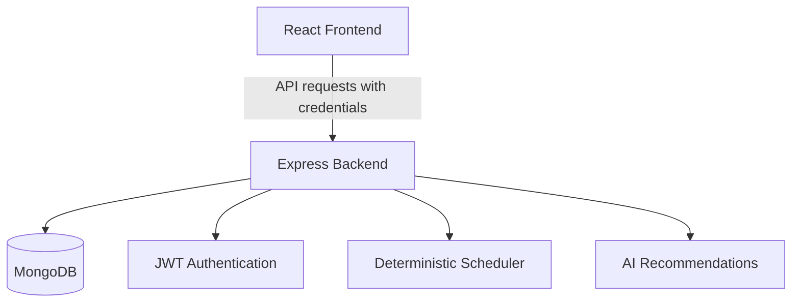

# AI Study Planner — Deployment Guide

This guide describes how to prepare AI Study Planner for production hosting. Deployment is not considered complete until the application has been deployed and the production checks in this guide have passed.

## 1. Deployment Architecture

The application requires three components:

- **Frontend:** React application built with Parcel.
- **Backend:** Node.js and Express API.
- **Database:** MongoDB, preferably MongoDB Atlas for a hosted deployment.

The frontend communicates with the backend over HTTP. Authentication uses JWTs stored in cookies, so the frontend origin, backend CORS configuration, cookie options, and HTTPS must work together.

## 2. Pre-deployment Checklist

Before deploying:

- [ ] Confirm the application runs locally.
- [ ] Run the scheduler test suite.
- [ ] Install dependencies and verify the frontend production build.
- [ ] Confirm the backend starts and connects to MongoDB.
- [ ] Review authentication cookie settings.
- [ ] Confirm all frontend API requests use the configured API base URL.
- [ ] Keep `.env` files and credentials out of Git.
- [ ] Prepare separate production environment variables.
- [ ] Verify the production frontend and backend domains.

Do not treat a check as complete until it has actually been performed.

## 3. MongoDB Configuration

A hosted MongoDB deployment can use MongoDB Atlas.

1. Create or select a MongoDB Atlas project and cluster.
2. Create a database user with an appropriate password.
3. Configure network access to allow connections from the backend hosting environment. Prefer the hosting provider's stable outbound IP when available rather than opening access broadly.
4. Copy the database connection URI.
5. Add the URI to the backend's `MONGODB_URI` environment variable in the hosting dashboard.
6. Keep the URI private.

The backend calls its database connection function before starting the HTTP server. A failed database connection prevents the server from starting successfully.

## 4. Backend Hosting

Choose a Node.js-compatible hosting service.

Use the backend's package scripts:

| Purpose | Command |
|---|---|
| Install dependencies | `npm install` |
| Start the application | `npm start` |
| Start in development mode | `npm run dev` |

Configure these environment variables in the hosting dashboard:

| Variable | Local development | Production |
|---|---|---|
| `PORT` | `5000` | Use the hosting platform's assigned port if required |
| `MONGODB_URI` | Local MongoDB URI | Private production database URI |
| `JWT_SECRET` | Local random secret | Separate, strong production secret |
| `FRONTEND_URL` | `http://localhost:1234` | Exact deployed frontend origin |
| `GEMINI_API_KEY` | Optional if AI features are unused | Required only if the AI integration is enabled |
| `GEMINI_MODEL` | `gemini-2.5-flash` | A model supported by the configured API key |
| `NODE_ENV` | Usually unset during local development | `production` |

Use the platform's secret/environment-variable manager. Do not put real values in this document or commit them to Git.

The backend package manifest and startup behavior should be checked again before selecting the final hosting configuration.

## 5. Frontend Hosting

The frontend uses Parcel.

From the `frontend/` directory, the intended commands are:

| Purpose | Command |
|---|---|
| Install dependencies | `npm install` |
| Start development server | `npm start` |
| Create production build | `npm run build` |

The frontend must send API requests to the deployed backend, not to `http://localhost:5000`.

Configure the frontend's `API_BASE_URL` using the mechanism supported by the actual frontend build. Since frontend environment variables can be embedded into generated JavaScript at build time, set the production value before building and verify the resulting bundle.

After the build succeeds, publish the generated production output directory using a static hosting service compatible with the application's client-side routing.

**Not yet verified:** the production build, the final output directory, and the production API URL embedded in the generated bundle.

## 6. CORS and Authentication Cookies

The backend enables credentialed CORS requests and allows origins configured through `FRONTEND_URL`. This variable supports comma-separated origins, with whitespace trimmed from each entry. Requests without an `Origin` header are also allowed.

### Production environment

Set these backend environment variables in the hosting dashboard:

- `NODE_ENV=production`
- `FRONTEND_URL` to the exact frontend origin, including `https://`
- `JWT_SECRET` to a long, randomly generated secret

The frontend must use the deployed backend URL and include credentials in requests that depend on authentication.

### Cookie behavior verified in the source

The login route signs a JWT with a one-day expiry and stores it in an HttpOnly cookie named `token`.

| Option | Development | Production |
|---|---|---|
| `httpOnly` | `true` | `true` |
| `secure` | `false` | `true` |
| `sameSite` | `lax` | `none` |
| `path` | `/` | `/` |

The logout route clears the `token` cookie using the same security options.

The cookie does not explicitly configure `maxAge` or `expires`, so it is a browser-session cookie. The JWT itself has a one-day expiry. These are distinct expiry behaviors and should not be described as identical.

### Production verification

- [ ] Deploy the frontend and backend over HTTPS.
- [ ] Confirm that the production server has `NODE_ENV=production`.
- [ ] Confirm that `FRONTEND_URL` matches the actual frontend origin exactly.
- [ ] Test login and inspect browser cookie storage to verify that `token` is HttpOnly, Secure, and configured with `SameSite=None`.
- [ ] Test `/api/auth/me` after login and confirm that an unauthenticated request is rejected.
- [ ] Test logout and verify that the cookie is cleared.
- [ ] Check browser developer tools for CORS errors or blocked-cookie warnings.

`SameSite=None` requires `Secure`. Browser privacy controls may still restrict cross-site cookies, so successful production authentication must be verified on the actual hosting domains.

## 7. Production Verification

After deployment, verify each item manually:

- [ ] Frontend loads over HTTPS.
- [ ] Backend health endpoint `/api/test` returns the expected response.
- [ ] User registration and login work.
- [ ] Authentication cookies are set with the intended production options.
- [ ] Protected routes reject unauthenticated requests.
- [ ] Study profile and availability can be retrieved and updated.
- [ ] Exams, subjects, and tasks can be created and edited.
- [ ] Study-plan generation and saved-plan retrieval work.
- [ ] Study-session start/stop and actual-time tracking work.
- [ ] Completing a task updates its status correctly.
- [ ] AI recommendations work when the Gemini key is configured.
- [ ] CORS rejects unapproved browser origins.
- [ ] No secret values appear in frontend bundles, logs, or public documentation.

Do not report a check as passed until it has been executed against the deployed application.

## 8. Troubleshooting

### Frontend cannot reach the API

- Confirm `API_BASE_URL` points to the deployed backend.
- Rebuild the frontend after changing build-time variables.
- Check browser developer tools for network and CORS errors.

### Login succeeds but protected requests fail

- Check that frontend requests include credentials.
- Inspect cookie options and browser cookie-blocking messages.
- Verify the configured frontend origin and backend CORS settings.
- Confirm the frontend and backend use HTTPS in production.

### Backend fails to start

- Review hosting logs.
- Verify `MONGODB_URI`, database network access, and database credentials.
- Confirm the hosting platform supplies the expected runtime and port.

### AI recommendations fail

- Confirm the backend has a valid `GEMINI_API_KEY`.
- Verify the configured model identifier.
- Check backend logs without exposing the API key.

## 9. Current Deployment Status

The deployment configuration described here is a preparation guide, not evidence of a live deployment.

The production build, hosted database connection, production cookie behavior, CORS across real domains, and end-to-end application workflows must be verified before the project can be described as deployed successfully.

## 10. Future Improvements and Remaining Work

- Complete and verify the production frontend build.
- Deploy the backend and frontend to selected hosting providers.
- Configure MongoDB Atlas and production secrets.
- Verify cookie authentication across the production domains.
- Run production smoke tests and end-to-end workflows.
- Add automated database-backed integration tests.
- Add monitoring and safe operational logging.
