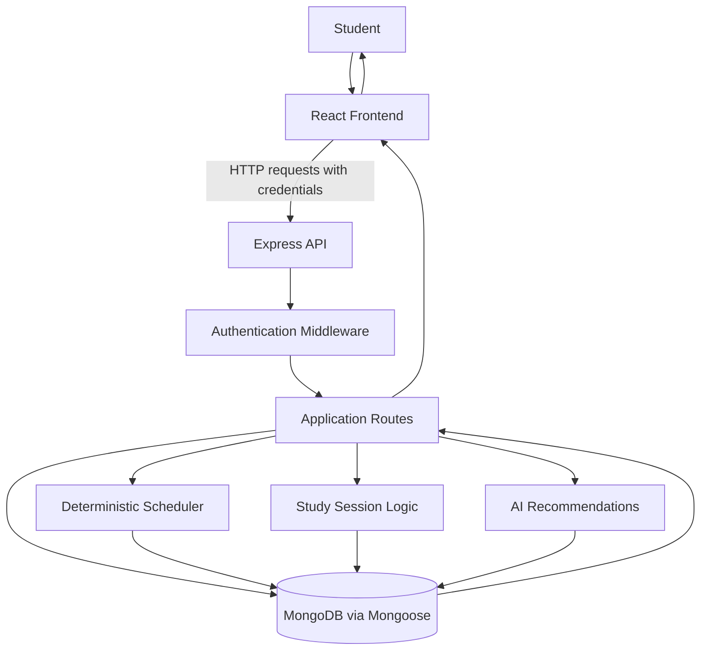

# AI Study Planner — Project Presentation Guide

## 1. Project Overview

### What is AI Study Planner?

AI Study Planner is a MERN-stack web application designed to help students organize pending academic tasks around their available study time, task priorities, and exam deadlines.

The application generates a study plan using deterministic scheduling logic. It also includes AI recommendation functionality to support study planning.

### Problem Statement

Students may have several subjects, assignments, and exams approaching at the same time. Planning manually can make it difficult to understand which tasks should be completed first and whether the available study time is sufficient.

### Proposed Solution

AI Study Planner allows users to manage their academic tasks and availability, generate a study plan, and track their actual study sessions.

The scheduler considers task eligibility, exam deadlines, priorities, estimated durations, and available time slots. When tasks cannot fit into the available time, the application can identify unscheduled work rather than pretending that every task can be completed.

### Main Objectives

- Organize academic tasks and exam deadlines in one application.
- Generate schedules using available study time.
- Prioritize tasks according to the scheduling rules.
- Track actual study time across study sessions.
- Identify work that cannot fit into the available schedule.
- Provide AI-based study recommendations separately from the core scheduling calculations.

### Technology Stack

| Layer | Technology |
|---|---|
| Frontend | React |
| Frontend tooling | Parcel |
| Backend | Node.js and Express |
| Database | MongoDB with Mongoose |
| Authentication | JWT in an HttpOnly cookie |
| Password security | bcrypt |
| Scheduling | Deterministic backend logic |
| AI recommendations | Gemini integration |

## 2. System Architecture and Request Flow

### Architecture Overview

The application follows a client-server architecture.

- **Frontend:** React displays the interface and sends API requests.
- **Backend:** Express handles API routes, authentication, validation, and application logic.
- **Database:** MongoDB stores application data using Mongoose models.
- **Scheduler:** Backend scheduling logic allocates eligible tasks to available study slots.
- **AI recommendation module:** Provides recommendation functionality separately from the deterministic scheduler.

### Architecture Diagram

The diagram represents the main logical components, not every internal function call.

### Example: Generating a Study Plan

1. The student requests study-plan generation from the frontend.
2. The frontend sends an API request to the Express backend with the required authentication credentials.
3. The backend identifies the authenticated user and obtains the relevant tasks and availability data.
4. The deterministic scheduler evaluates eligible tasks, deadlines, estimated durations, and available slots.
5. The generated plan records scheduled and unscheduled work.
6. The backend saves the plan in MongoDB.
7. The frontend displays the returned result.

The exact behavior depends on the current implementation of the relevant route and scheduler.

### Why Use a Backend Scheduler?

Scheduling involves constraints such as deadlines, available minutes, and task durations. These calculations should be handled by predictable backend logic rather than delegated to an AI model.

This makes it easier to test the scheduler, explain its decisions, and detect when work cannot fit into the available time.

## 3. Deterministic Scheduling Algorithm

### How It Works

The scheduler converts pending academic work and available study time into a practical study plan.

1. Retrieve the relevant tasks, exams, and availability.
2. Exclude tasks that are already completed.
3. Consider exam deadlines when ordering eligible tasks.
4. Apply the existing priority rules.
5. Allocate tasks to available slots while respecting their estimated durations.
6. Record tasks that cannot be scheduled and the reasons, where supported by the implementation.
7. Save the generated plan for later retrieval.

### Scheduling Rules

- Only pending tasks should be scheduled.
- A task must not be scheduled on or after its exam date.
- The nearer exam deadline takes precedence over a later exam according to the existing scheduling rules.
- Tasks must fit within available slot capacity.
- Multiple tasks may occupy different portions of the same availability slot.
- The scheduler should not fill every available minute unnecessarily.
- If work cannot fit before the relevant deadline, it should be reported as unscheduled.

### Why Deterministic Scheduling?

Deterministic logic produces repeatable, testable results for the same inputs. An AI model may explain a recommendation, but it should not override scheduling constraints or calculate authoritative time allocations.

### Important API Distinction

- `POST /api/study-plan/generate` generates and saves a plan.
- `GET /api/study-plan` retrieves saved plans rather than generating a new one.

## 4. Authentication and Security

### Authentication Flow

1. A user registers with the application.
2. The backend hashes the password using bcrypt before storing it.
3. During login, the backend verifies the password.
4. The backend issues a JWT and places it in an HttpOnly cookie.
5. Protected routes use authentication middleware to identify the user.
6. User-specific operations should be restricted to resources owned by that authenticated user.

### Security Measures

- Password hashing with bcrypt.
- JWT-based authentication.
- HttpOnly cookies to reduce JavaScript access to authentication tokens.
- Credentialed frontend API requests.
- CORS configuration for permitted frontend origins.
- Backend validation and ownership checks.

An HttpOnly cookie helps protect a token from direct JavaScript access, but it does not eliminate every security risk. Production deployment also requires correct HTTPS, cookie, CORS, and origin configuration.

## 5. Study Sessions and Actual Study Time

### Study Session Flow

A study session represents an actual period spent working on a task. It is different from a scheduled availability slot.

1. The student starts an eligible task.
2. The backend records the session start time.
3. The student continues studying.
4. When the student stops, the backend records the end time.
5. The session duration contributes to the task's accumulated actual study time, according to the implementation.

### Important Design Decisions

- A completed task should not be started again.
- A user should not have conflicting active sessions if the application permits only one active session at a time.
- Stopping a session should not automatically mark the task completed.
- Marking a task completed should update its status and handle any active session according to the implemented workflow.
- Session timestamps and duration calculations should be controlled by the backend.

The exact behavior should be demonstrated and verified against the current source code before making stronger claims.

## 6. AI Recommendations

The project includes an AI recommendation route intended to support study planning.

The key architectural distinction is that the scheduler remains responsible for deterministic allocation and deadline constraints, while the AI module provides recommendations.

This separation helps keep scheduling decisions predictable and testable.

**Presentation note:** Demonstrate the recommendation feature only after verifying that the required API configuration and Gemini integration work in the current environment. Do not describe an untested live AI response as verified.

## 7. Suggested Live Demonstration

Use this sequence when presenting the project:

1. Register or log in to the application.
2. Show the study profile and daily study-hour settings.
3. Show the availability configuration.
4. Show the exams, subjects, and pending tasks.
5. Generate a study plan.
6. Explain one scheduled task and one unscheduled task.
7. Start and stop a study session.
8. Show the task's completion workflow and actual-time tracking.
9. Demonstrate AI recommendations if the integration is available.
10. Explain the remaining limitations honestly.

Use your own test data and verify each step before the demonstration.

## 8. Interview Questions and Suggested Answers

### Q1. Why did you use the MERN stack?

React supports a component-based interface, Express and Node.js provide the API layer, and MongoDB stores application data. Mongoose provides schemas and data-model operations.

### Q2. Why not let AI generate the entire timetable?

AI output may be inconsistent or fail to respect strict time constraints. Deterministic scheduling makes allocation predictable and testable. AI can assist with recommendations without controlling the authoritative schedule.

### Q3. What is the difference between a slot and a study session?

A slot represents available time in the schedule. A study session records the actual time a student spends working on a task.

### Q4. What happens when there is insufficient study time?

The scheduler should report work that cannot fit into the available slots rather than falsely presenting an infeasible plan as complete.

### Q5. Why use JWT in an HttpOnly cookie?

The cookie carries the authentication token without exposing it directly to normal JavaScript access. The backend verifies the token on protected requests.

### Q6. How do you prevent users from accessing each other's tasks?

The backend should derive the user identity from the authenticated request and enforce ownership checks on every user-specific resource.

### Q7. How do you test the scheduler?

Use automated tests for scheduling rules, including deadline ordering, task eligibility, slot capacity, and unscheduled tasks. Report only the test results actually observed.

### Q8. What would you improve next?

Possible improvements include adaptive replanning after overruns, break handling, study analytics, temporary availability overrides, stronger integration tests, and improved deployment monitoring.

## 9. Limitations and Future Improvements

The following items must be checked against the current implementation before the presentation:

- Break handling and break-aware estimates.
- Adaptive replanning after a session overruns its slot.
- Planned-versus-actual study analytics.
- Behavior-based personalization.
- Temporary daily availability overrides.
- Additional dashboard and analytics features.
- Complete exam update/delete behavior and dependent-record handling.
- Production deployment and database-backed integration testing.

## 10. Final Presentation Checklist

Before the interview or project demonstration:

- [ ] The frontend starts successfully.
- [ ] The backend connects to the database.
- [ ] Login and protected API requests work.
- [ ] Task creation and completion work.
- [ ] Plan generation and saved-plan retrieval work.
- [ ] Scheduled and unscheduled tasks display correctly.
- [ ] Study session start and stop work.
- [ ] AI recommendations work if included in the demonstration.
- [ ] The documented test results match the actual results.
- [ ] Unfinished features are clearly identified.

