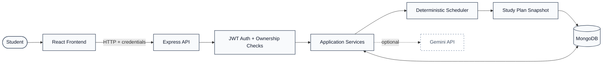

# AI Study Planner

A MERN-based study planning application that helps students organize pending tasks around exam deadlines and available study time. It combines deterministic scheduling, actual study-session tracking, and optional AI-powered recommendations.

## The Problem

Students often struggle to distribute their remaining study work across limited available time, prioritize approaching exams, and adjust plans when their progress changes.

## The Solution

AI Study Planner uses a deterministic backend scheduler to allocate eligible pending tasks within available study slots and before exam deadlines. It tracks actual study time and creates updated plan snapshots when relevant data changes. Optional Gemini recommendations provide additional guidance without controlling the scheduling calculations.

## System Architecture



## Key Features

- User registration and login with bcrypt, JWT, and HttpOnly cookies.
- Study profile and recurring weekly availability management.
- Exam, subject, and task creation and editing.
- Deterministic study-plan generation based on deadlines and available slots.
- Saved study-plan history and replanning of remaining work.
- Study-session start/stop controls and actual-time tracking.
- Task completion and reopening workflows.
- Optional Gemini-based study recommendations.
- Responsive interface with sidebar navigation.

## Technology Stack

| Layer              | Technologies                              |
| ------------------ | ----------------------------------------- |
| Frontend           | React, React Router, Parcel               |
| Backend            | Node.js, Express                          |
| Database           | MongoDB, Mongoose                         |
| Authentication     | bcrypt, JSON Web Tokens, HttpOnly cookies |
| Scheduling         | Deterministic JavaScript scheduling logic |
| AI recommendations | Gemini API, optional                      |

## How It Works

1. Register and sign in.
2. Configure weekly availability.
3. Add exams, subjects, and pending study tasks.
4. Generate a study plan.
5. Start and stop study sessions to record actual study time.
6. Complete tasks and replan the remaining work when needed.

## Project Documentation

- [Project Architecture](PROJECT-ARCHITECTURE.md)
- [Engineering Design Notes](ENGINEERING-DESIGN-NOTES.md)
- [Audit and Change Report](AUDIT-AND-CHANGE-REPORT.md)
- [Deployment Guide](DEPLOYMENT-GUIDE.md)
- [Project Presentation Guide](PROJECT-PRESENTATION-GUIDE.md)
- [Presentation Quick Reference](PRESENTATION-QUICK-REFERENCE.md)

## Requirements

- Node.js 22 or a compatible recent version.
- MongoDB local instance or MongoDB Atlas.
- Gemini API key only if AI recommendations are required.

## Run Locally

### 1. Configure the backend

```powershell
cd backend
npm install
Copy-Item .env.example .env
```

Edit `backend/.env` and configure `MONGODB_URI`, `JWT_SECRET`, `PORT`, and `FRONTEND_URL`. Keep the real `.env` file private.

### 2. Start the backend

```powershell
npm run dev
```

### 3. Configure and start the frontend

Open a second terminal from the repository root:

```powershell
cd frontend
npm install
Copy-Item .env.example .env
npm start
```

Parcel normally serves the frontend at `http://localhost:1234`, and the backend uses `http://localhost:5000` with the supplied local configuration.

## Testing

Run these commands from `backend/`:

```powershell
node scripts/testScheduler.js
node scripts/testAvailableSlots.js
```

The scheduler suite was previously reported as passing 55 tests with zero failures. The available-slot test and frontend production build still require successful dependency installation and verification. Database-backed integration tests and live Gemini calls have not been fully verified.

## Deployment Status

This repository is prepared for deployment work, but the application must not be considered live until the frontend, backend, database connection, authentication cookies, CORS, and key application workflows have been tested on the actual hosting domains.

## Future Improvements

- Database-backed integration tests for authentication, tasks, and study sessions.
- Planned-versus-actual study analytics.
- Optional daily availability overrides.
- Improved AI request timeout, retry, and usage controls.
- A documented policy for deleting exams or subjects with dependent records.
- Production deployment and end-to-end verification.

## Security

Never commit `.env` files, database credentials, JWT secrets, or API keys. Use environment-variable settings provided by your hosting platform for production configuration.
